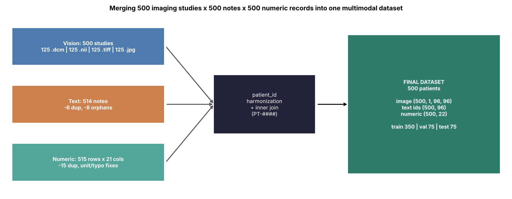
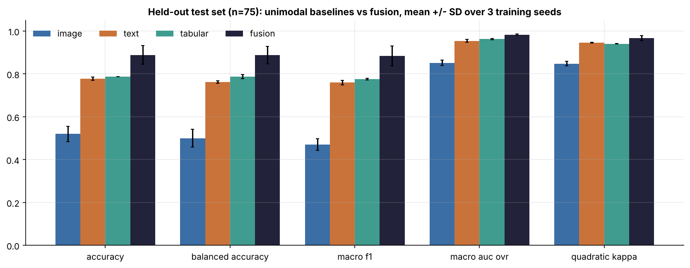
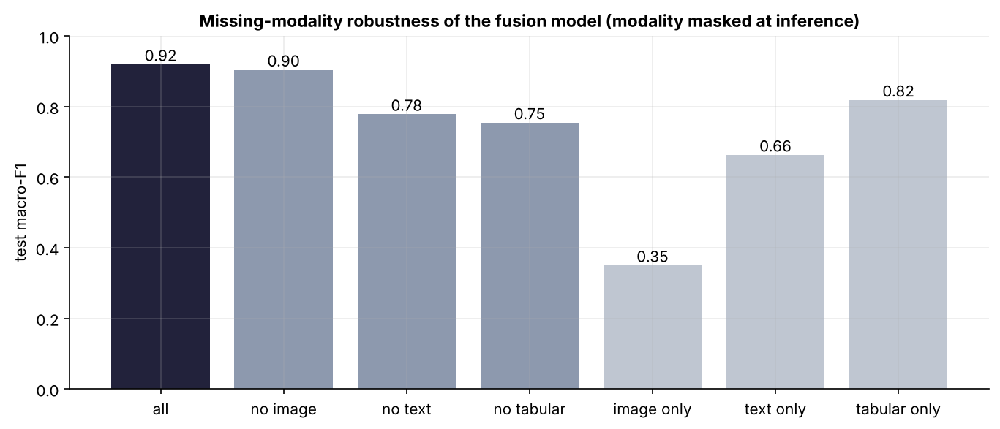
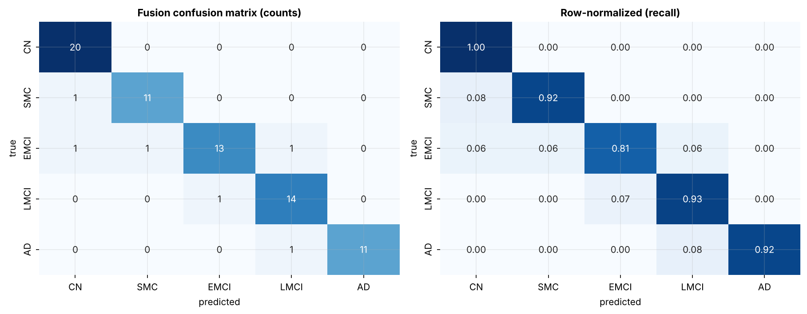
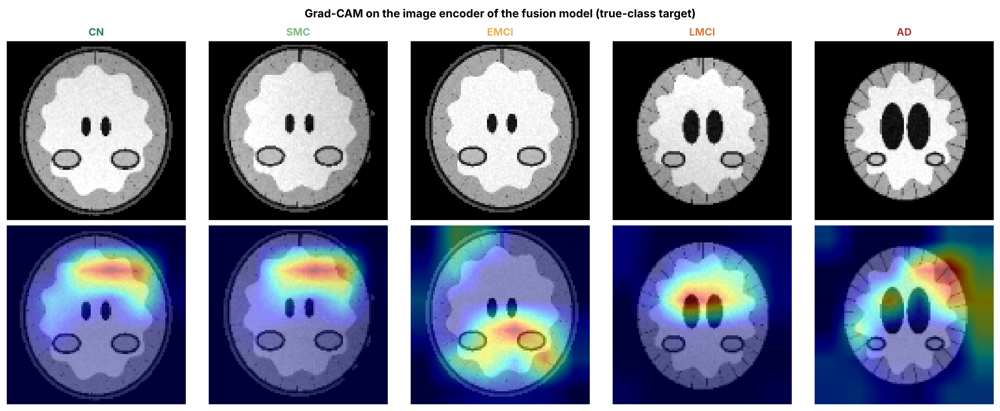

# Multimodal Alzheimer's Disease Diagnostic Model (5-class)

**Vision + text + numeric fusion for CN / SMC / EMCI / LMCI / AD classification, from raw multi-format neuroimaging to a containerized, Kubernetes-ready inference service.**

> Research and education only. All data are **fully synthetic**; nothing here is a medical device or has been validated on patients.



## Highlights

| | |
|---|---|
| **Source data** | 500 MRI studies in 4 formats (125 each `.dcm` `.nii` `.tiff` `.jpg`), 514 clinical notes, 515 biomarker rows, all with realistic defects |
| **Final dataset** | 500 patients x {image 1x96x96, 96 tokens, 22 numeric features}; stratified 350 / 75 / 75 split |
| **Model** | PyTorch residual CNN + Hugging Face `BertModel` + MLP, gated modality attention, modality dropout, auxiliary per-modality losses |
| **Test macro-F1** | Fusion **0.88 +/- 0.05** (3 seeds) vs best single modality 0.78 +/- 0.00; deployed model 0.92 (95% CI 0.84 to 0.98), macro AUC 0.99 |
| **ROI detector** | Ultralytics YOLO11n (hippocampus, ventricles): test mAP50 0.995, mAP50-95 0.93 |
| **Deployment** | ONNX (exact parity, 2.0 ms/patient on CPU), ONNX Runtime, FastAPI, Docker, Kubernetes HPA, Triton + TensorRT FP16, DeepStream, Core ML |
| **DICOM / PACS** | PS3.15 de-identification, pynetdicom C-ECHO / C-STORE verified, DICOMweb client, Orthanc in docker-compose |

## Results (held-out test set, n = 75)

| Model (mean +/- SD over 3 seeds) | Accuracy | Balanced acc. | Macro-F1 | Macro AUC |
|---|---|---|---|---|
| Image only | 0.52 +/- 0.04 | 0.50 +/- 0.04 | 0.47 +/- 0.03 | 0.85 +/- 0.01 |
| Text only | 0.78 +/- 0.01 | 0.76 +/- 0.01 | 0.76 +/- 0.01 | 0.95 +/- 0.01 |
| Numeric only | 0.79 +/- 0.00 | 0.79 +/- 0.01 | 0.78 +/- 0.00 | 0.96 +/- 0.00 |
| **Fusion** | **0.89 +/- 0.04** | **0.89 +/- 0.04** | **0.88 +/- 0.05** | **0.98 +/- 0.00** |

Deployed fusion model (best validation seed): per-class F1 CN 0.95, SMC 0.92, EMCI 0.87, LMCI 0.90, AD 0.96; ECE 0.080 to 0.036 after temperature scaling. It stays usable with a modality missing (macro-F1 0.90 without image, 0.78 without text, 0.75 without numeric). The weakest area is JPEG-sourced scans (subgroup accuracy 0.83 vs 0.94 to 1.00 for lossless formats).

| | |
|---|---|
|  |  |
|  |  |

## Repository layout

```
multimodal-ad-diagnosis/
├── configs/config.yaml               # single source of truth: classes, sizes, hyper-parameters, seeds
├── data/
│   ├── raw/imaging/{dicom,nifti,tiff,jpg}   # synthetic MRI in 4 formats + manifest + ROI boxes
│   ├── raw/clinical_notes/                  # free-text notes (dups, orphans, empties)
│   ├── raw/tabular/                         # demographics, cognition, volumetrics, plasma biomarkers
│   ├── interim/                             # QC table, cleaned notes/tabular, de-identified DICOM
│   ├── processed/                           # final merged dataset (CSV + .npy tensors)
│   └── yolo/                                # YOLO-format ROI dataset (data.yaml)
├── notebooks/                        # 01-09: generation, EDA x3, preprocessing, training, evaluation, YOLO/curation, deployment
├── src/ad_mm/
│   ├── data/generate_synthetic.py    # synthetic vision/text/numeric generator
│   ├── preprocessing/                # imaging.py, text.py, tabular.py, merge.py
│   ├── eda/run_eda.py                # all EDA figures
│   ├── models/multimodal.py          # CNN + HF BERT + MLP + gated fusion
│   ├── training/train.py             # multi-seed training, unimodal baselines
│   ├── evaluation/evaluate.py        # metrics, CIs, calibration, ablation, subgroups, Grad-CAM
│   ├── dicom/                        # de-identification, PACS (DIMSE + DICOMweb)
│   ├── integrations/                 # yolo_roi, fiftyone_curation, roboflow_sync, v7_darwin
│   └── deployment/                   # export_onnx, onnx_inference, serve_api, tensorrt_build, coreml_export
├── deployment/
│   ├── docker/                       # Dockerfile (CPU), Dockerfile.gpu (TensorRT), docker-compose (Orthanc + API + Prometheus)
│   ├── k8s/                          # Deployment, Service, HPA, PDB, NetworkPolicy, Ingress, Triton GPU
│   ├── triton/model_repository/      # Triton config.pbtxt (dynamic batching, TensorRT FP16)
│   └── deepstream/                   # nvinfer config for the YOLO ROI detector
├── models/                           # ONNX (FP32/INT8), tokenizer, tabular transformer, YOLO weights
├── reports/figures/                  # 33 PNG figures
├── reports/metrics/                  # JSON/CSV metrics, logs, predictions
├── docs/                             # 2-page workflow summary (.md + .docx)
├── tests/test_pipeline.py            # 15 unit + integration tests (incl. API end-to-end)
└── scripts/run_pipeline.sh           # one command, end to end
```

## Quickstart

```bash
git clone https://github.com/<you>/multimodal-ad-diagnosis.git && cd multimodal-ad-diagnosis
python -m venv .venv && source .venv/bin/activate
pip install -r requirements.txt && pip install -e .

bash scripts/run_pipeline.sh          # data -> EDA -> preprocess -> train -> evaluate -> DICOM/PACS -> YOLO -> ONNX -> tests (~25 min CPU)
python scripts/build_notebooks.py --execute

uvicorn ad_mm.deployment.serve_api:app --port 8080      # API docs at http://localhost:8080/docs
curl -F image=@data/raw/imaging/dicom/PT-0001.dcm -F note="patient reports forgetfulness" \
     -F numeric='{"age": 74, "mmse": 26, "moca": 22}' http://localhost:8080/predict
```

Containers and cluster:

```bash
docker compose -f deployment/docker/docker-compose.yml up --build    # Orthanc PACS + API + Prometheus
kubectl apply -f deployment/k8s/ad-mm-deployment.yaml               # CPU service with autoscaling
python -m ad_mm.deployment.tensorrt_build --onnx models/ad_mm_fusion.onnx --fp16     # on a GPU host
```

## Pipeline

1. **Generate** (`generate_synthetic.py`): a latent severity drives all three modalities with independent noise, so each is only partly informative (SMC vs CN lives mostly in text, EMCI vs LMCI in cognition, LMCI vs AD in atrophy and function).
2. **EDA** (figures 01 to 20): format inventory, scanner effects, DICOM header audit, NIfTI views, QC, TF-IDF vocabulary, missingness, unit and typo detection, correlations, PCA.
3. **Preprocess and merge**: format-agnostic loading, denoise, orientation QC, skull strip, z-score; note cleaning and WordPiece tokenizer; tabular unit/typo fixes, imputation and scaling fitted on train only; inner join on harmonized `PT-####`.
4. **Train**: 4 model families x 3 seeds; best-validation seed promoted (no test-set selection).
5. **Evaluate** (figures 21 to 30): bootstrap CIs, ROC/PR, calibration, modality attention, missing-modality ablation, subgroup accuracy, Grad-CAM, permutation importance.
6. **ROI detection and curation**: YOLO11n trained and exported to ONNX; FiftyOne / Roboflow / V7 connectors (need their packages and API keys).
7. **Deploy**: ONNX with calibrated softmax, parity check, INT8 quantization, latency benchmark, FastAPI, Docker, Kubernetes, Triton, DeepStream, Core ML.

## What is executed vs provided as integration code

Executed and tested here: data generation, EDA, preprocessing, PyTorch / Hugging Face training, evaluation, DICOM de-identification, pynetdicom C-ECHO/C-STORE against a local SCP, YOLO training and ONNX export, ONNX Runtime inference and benchmark, FastAPI (via TestClient), notebooks, 15 tests.
Provided and syntax-checked but needing external services or hardware: FiftyOne app, Roboflow and V7 uploads (API keys), TensorRT / Triton / DeepStream (NVIDIA GPU), Core ML conversion (coremltools, ideally macOS), Docker builds and Kubernetes apply.

## Limitations

Synthetic 2D phantoms are far simpler than real 3D T1 MRI; the image branch is the weakest component; n = 75 test patients gives wide intervals. Real use requires external validation (e.g. ADNI, AIBL, BioFINDER), a pretrained 3D backbone, clinical language models, and a regulatory quality system. See `docs/AD_Multimodal_Workflow_2pager.md`.

## License

MIT. Author: YO.
