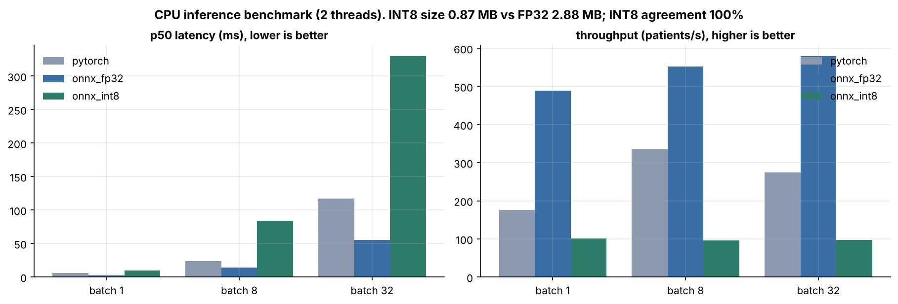

# Multimodal Alzheimer's Disease Diagnostic Model (5-Class): Workflow and Pipelines

**Author:** YO | **Date:** October 2026 | **Status:** Research prototype on fully synthetic data. Not a medical device.

## 1. Objective and problem statement
Distinguishing the Alzheimer's continuum is hard because the signal is spread across modalities: subjective decline appears in what patients and families report, MCI staging in cognitive scores, and dementia in atrophy and functional loss. **Goal:** build and deploy one model that fuses structural MRI (vision), clinical notes (text) and cognitive, volumetric and plasma biomarkers (numeric) to classify patients as **CN, SMC, EMCI, LMCI or AD**, and that keeps working when a modality is missing.

## 2. Clinical and regulatory considerations
- **Intended use:** clinical decision support for neurologists and memory-clinic specialists, not autonomous diagnosis. Low-confidence or QC-failed cases are routed to the clinician (`refer_to_clinician` flag).
- **Regulatory path (US):** Software as a Medical Device; a novel 5-class diagnostic claim most likely needs De Novo, versus 510(k) for narrower volumetric claims. Follow FDA Good Machine Learning Practice, a Predetermined Change Control Plan for retraining, QMSR (ISO 13485 aligned), IEC 62304, ISO 14971 risk management, and 21 CFR Part 11 audit trails (implemented as PHI-free request logs with model version).
- **Privacy:** DICOM de-identification (PS3.15 Basic Profile subset, consistent UID remap, date shift), numbers stripped from notes, only de-identified derivatives sent to annotation vendors under a BAA.
- **Clinical validity:** labels should follow NIA-AA / ADNI criteria with amyloid confirmation; validate across sites, scanners, age, sex and APOE4 status; real-world prevalence differs between memory clinics and primary care (spectrum bias).

## 3. Tools for end-to-end development and deployment
| Stage | Tools |
|---|---|
| Data and imaging I/O | pydicom, nibabel, tifffile, Pillow, OpenCV, SciPy |
| DICOM workflow and PACS | pydicom de-identification, pynetdicom (C-ECHO/C-FIND/C-MOVE/C-STORE), DICOMweb (QIDO/WADO/STOW), Orthanc |
| Curation and annotation | FiftyOne (uniqueness, mistakenness), Roboflow (labelling, versioning), V7 Darwin (expert DICOM/NIfTI annotation) |
| Modelling | PyTorch, Hugging Face `transformers` + `tokenizers` (BERT), Ultralytics YOLO11 (ROI detection), scikit-learn |
| Deployment | ONNX, ONNX Runtime (CPU/CUDA/TensorRT/CoreML providers), NVIDIA TensorRT + Triton + DeepStream, Core ML, FastAPI, Docker, Kubernetes (HPA, PDB, NetworkPolicy), Prometheus |

## 4. Data and preprocessing
Three synthetic source datasets were generated for 500 patients (CN 130, SMC 80, EMCI 110, LMCI 100, AD 80) with deliberate real-world defects, then harmonized and merged (**500 studies x 500 notes x 500 numeric records -> 500 multimodal patients**).
- **Vision (125 each of .dcm, .nii, .tiff, .jpg):** format-specific loaders produce one axial slice; resize to 96x96, percentile rescale, non-local-means denoising when the noise index exceeds threshold, orientation check against a population template, connected-component skull stripping, and brain-masked z-scoring to remove scanner-vendor intensity differences. QC caught and fixed 100% of flipped and high-noise studies with no false positives.
- **Text (514 notes):** removed 6 duplicates and 8 orphan notes, filled 3 empty notes, expanded clinical abbreviations, replaced numbers, kept the latest note per patient; WordPiece tokenizer trained on the training split only.
- **Numeric (515 rows, 21 columns):** removed 15 duplicate rows, harmonized IDs and label/sex coding, fixed 103 cm3-to-mm3 unit errors at one site and 6 decimal typos, added missing indicators for plasma markers, then median imputation, log transform and z-scoring fitted on train.
- **Merge and split:** inner join on harmonized `PT-####`, stratified patient-level 70/15/15 split (350/75/75). Final tensors: image (500, 1, 96, 96), tokens (500, 96), numeric (500, 22).

## 5. Model development
Three encoders feed a fusion head: a residual CNN for MRI, a Hugging Face `BertModel` (2 layers) for notes, and an MLP for numeric features. A **gated attention layer** weights the three 128-d embeddings per patient (interpretable), **modality dropout** (25%) trains robustness to missing inputs, and **auxiliary per-modality losses** stop the model from leaning on the easiest modality. Training used class-weighted cross-entropy with label smoothing, AdamW with one-cycle LR and early stopping on validation macro-F1. Each model was trained with 3 seeds; the best-validation seed is deployed. A YOLO11n detector localizes the hippocampus and lateral ventricles for ROI QC and future high-resolution crops.

## 6. Performance evaluation and results (held-out test set, n = 75)
| Model (mean +/- SD, 3 seeds) | Accuracy | Macro-F1 | Macro AUC |
|---|---|---|---|
| Image only | 0.52 +/- 0.04 | 0.47 +/- 0.03 | 0.85 +/- 0.01 |
| Text only | 0.78 +/- 0.01 | 0.76 +/- 0.01 | 0.95 +/- 0.01 |
| Numeric only | 0.79 +/- 0.00 | 0.78 +/- 0.00 | 0.96 +/- 0.00 |
| **Fusion** | **0.89 +/- 0.04** | **0.88 +/- 0.05** | **0.98 +/- 0.00** |

- **Deployed fusion model:** accuracy 0.92, macro-F1 0.92 (95% bootstrap CI 0.84 to 0.98), macro AUC 0.99, quadratic kappa 0.97. Per-class F1: CN 0.95, SMC 0.92, EMCI 0.87, LMCI 0.90, AD 0.96. Temperature scaling cut calibration error (ECE) from 0.080 to 0.036.
- **Missing-modality robustness (macro-F1):** all 0.92; without image 0.90; without text 0.78; without numeric 0.75; numeric alone 0.82.
- **Subgroups:** stable across sex (0.91 / 0.92) and APOE4 status (0.93 / 0.92). JPEG-sourced scans were weakest (0.83 vs 0.94 to 1.00 for lossless formats), so lossy images should be flagged at intake.
- **Explainability:** modality attention weights, Grad-CAM on the image encoder, and permutation importance (self-reported ECog, CDR-SB and MoCA rank highest). YOLO ROI detector: test mAP50 0.995, mAP50-95 0.93.
- **Caveat:** the image branch is the weakest component, and n = 75 gives wide intervals; results on synthetic data do not predict clinical performance.

## 7. Model deployment
The fusion model is exported to **ONNX** with calibrated softmax built in. ONNX Runtime matches PyTorch exactly (max difference 3e-7, 100% agreement) and runs at **2.0 ms per patient** on 2 CPU threads (2.8x faster than PyTorch; 580 patients/s at batch 32). Dynamic INT8 shrinks the model 3.3x with identical predictions but is slower on CPU, so INT8 is reserved for TensorRT with calibration on GPU. The **FastAPI** service accepts any image format plus note and numeric JSON, applies the identical preprocessing, and returns probabilities, modality weights, QC and a referral flag. It ships as a non-root **Docker** image and runs on **Kubernetes** (2 to 10 replicas via HPA, probes, PDB, NetworkPolicy, TLS ingress). High-volume GPU serving uses **Triton** with **TensorRT FP16** and dynamic batching; **DeepStream** runs the YOLO ROI detector on streamed slices; **Core ML** export supports on-device inference. PACS integration was verified with C-ECHO and C-STORE (5/5 studies, 0.3 s), and results go back to PACS as a DICOM Secondary Capture.

## 8. Next steps and post-deployment activities
1. **Real-data validation:** retrain and externally validate on ADNI, AIBL and BioFINDER using 3D T1 volumes, a pretrained 3D backbone and Bio_ClinicalBERT; run a prospective reader study against neuroradiologists.
2. **Monitoring:** track input drift (scanner, protocol, format mix), prediction-class mix, confidence and referral rate through Prometheus; run monthly subgroup performance audits on adjudicated cases.
3. **Controlled updates:** retrain under the PCCP with locked test sets, champion/challenger shadow deployment, and rollback.
4. **Clinical integration:** HL7 FHIR output to the EHR, DICOM SR in place of Secondary Capture, clinician feedback loop into FiftyOne / V7 for relabelling.
5. **Safety and security:** post-market surveillance and complaint handling, annual bias review, SBOM, image signing and penetration testing.
